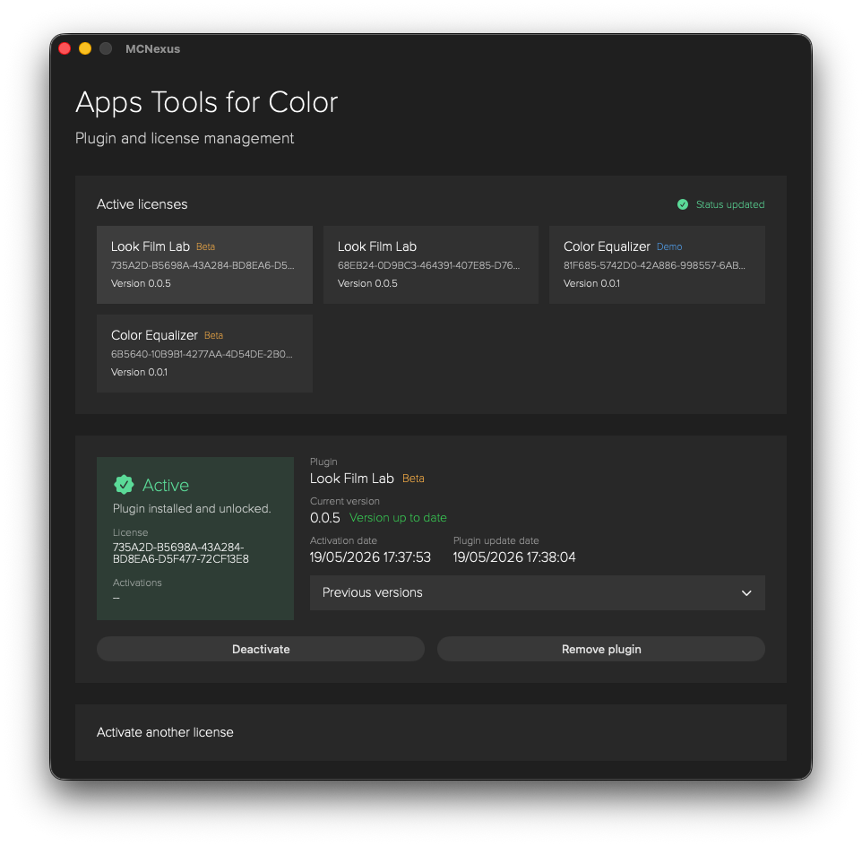
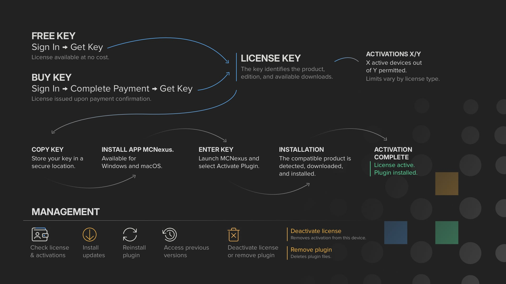

---

[English](README.md) · [Português](pt-BR/README.md) · [Website](https://mcnexus.app/)

**Infrastructure for plugin distribution, licensing, and updates.**

Integrated checkout, node-locked licensing, native installation, and updates on
macOS and Windows, with native DCTL-to-OFX conversion, MIDI hardware control,
and a ready-to-run SDK Sandbox.

Nexus is infrastructure for licensing, distributing, and updating native
desktop plugins and software: activation certificates signed per tenant and
bound to machine hardware, an offline validity window that survives days without
a network, protected release delivery, rollback to a previous version, native
DCTL-to-OFX packaging, and physical MIDI hardware control (`NexControl`).
MCNexus is the macOS and Windows application that performs activation,
installation, updates, rollback, and hardware MIDI hub routing on the workstation.

<table>
  <tr>
    <td width="65%">
      
    </td>
    <td>
      
       
      <small>Recommended for Windows</small>
        
      
       
      
    </td>
  </tr>
</table>

The **Microsoft Store is the official and recommended installation channel for Windows**, providing code integrity and automatic background updates. The `.exe` installer remains available through GitHub as an alternative for manual installation.

> **Installation notice:** the direct Windows installer distributed through GitHub is not currently code-signed and may display a Microsoft Defender SmartScreen warning. The macOS build is not currently signed with an Apple Developer ID certificate or notarized by Apple, so Gatekeeper may also display a warning. Official downloads are available through the Microsoft Store and this repository.

## Discover Plugins

Explore the OFX plugins already integrated with Nexus.

[View integrated plugins](docs/DISCOVERY.md) · [Suggest a plugin](https://github.com/ciqueira/MCNexus/issues/new?template=plugin_suggestion.yml)

## For Users

MCNexus manages the lifecycle of plugins installed on a workstation, from initial activation to installing a previous version.

- **Automatic installation:** downloads and installs OFX bundles in the native directory defined by the operating system.
- **Updates and rollback:** detects published versions and installs an update or reverts to a previous release, verifying SHA256 integrity before applying changes.
- **Independent actions:** activating a license, deactivating it, removing the local key, and removing plugin files are separate operations.
- **Hardware MIDI control (`NexControl`):** connects supported physical MIDI controllers to compatible OFX plugins in DaVinci Resolve with automatic active-node tracking, virtual bank navigation, and customizable profiles, without requiring OS Accessibility permissions.
- **Moving between computers and offline suites:** deactivate a license on an accessible workstation before activating it on another, or use exported files for offline (air-gapped) environments. Remote seat releases still require support.

[Start with the User Guide](docs/USER_GUIDE.md)

## For Developers

Backend, native SDK, and desktop client for commercial or open-source software. Integrations work end-to-end (from integrated checkout to workstation delivery) or coupled to an existing external store or license issuer. Configured project by project; public self-service onboarding is on the [roadmap](docs/ROADMAP.md).

- **Native SDK (`NexKeyRuntime`).** C/C++ with a stable C ABI (`1.0`) for macOS universal (`arm64` and `x86_64`), Windows x64, and Windows ARM. License checks on the render thread perform a single atomic memory read with zero network or disk I/O. Supports hardware-bound activation, configurable offline validity (up to 365 days), file-based air-gapped activation, and an offline Developer Sandbox for immediate testing before onboarding.
  → [NexKeyRuntime](https://github.com/ciqueira/NexKeyRuntime) · [Integration](https://github.com/ciqueira/NexKeyRuntime/blob/main/docs/INTEGRATION.md) · [ABI policy](https://github.com/ciqueira/NexKeyRuntime/blob/main/docs/ABI_POLICY.md) · [Licensing and SDK](docs/developers/LICENSING.md)

- **Desktop Client, Updates, and Rollback (`MCNexus`).** The macOS and Windows app handles activation, installation, channel-aware updates, and SHA256-verified rollbacks. Activating outside the host keeps the plugin Inspector clean, avoids writing user credentials into project files (such as `.drp`), and supports in-place upgrades from `Demo` or `Trial` to `Full` on the same key without reinstalling or breaking saved timelines.
  → [User Guide](docs/USER_GUIDE.md) · [Releases and rollback](docs/developers/RELEASES.md)

- **DCTL-to-OFX Packaging.** Packages DCTL color scripts and 3D LUTs into native OpenFX plugins with no C++ code required, running on precompiled GPU runners for macOS (Metal) and Windows (OpenCL).
  → [DCTL-to-OFX guide](docs/developers/DCTL.md)

- **Hardware MIDI Control (`NexControl`).** Bridges physical MIDI surfaces to OpenFX parameters with automatic active-node focus tracking on macOS and Windows, virtual bank pagination, adaptive encoder scaling, and built-in or custom JSON profiles.
  → [NexControl MIDI guide](docs/developers/MIDI.md)

- **Commerce, In-Product Notices, and Continuity.** Supports direct sales through the developer's payment account (or external stores via API) with acceptance records and transactional receipts, localized notices targeted by host and version, and developer-held signing and recovery keys so existing installations remain operable independently of Nexus infrastructure.
  → [Commerce and fulfillment](docs/developers/COMMERCE.md) · [Updates and notices](https://github.com/ciqueira/NexKeyRuntime/blob/main/docs/UPDATES_AND_NOTICES.md) · [Continuity and recovery](docs/CONTINUITY.md)

[Read the Developer Documentation](docs/DEVELOPERS.md)

## Application Compatibility

- **macOS:** macOS 15 or later, including Apple Silicon and supported Intel Macs.
- **Windows:** Windows 10/11 x64, with Windows 11 ARM support through x64 emulation.
- **Linux:** under consideration when compatible plugins and user demand
  justify the additional platform lifecycle.

## Project

Nexus combines software engineering with practical experience in audiovisual
post-production. Developed independently by
[Magno Ciqueira](https://www.linkedin.com/in/ciqueira/)
([Instagram](https://www.instagram.com/magnociqueira/)), the project aims to
reduce technical friction and provide distribution infrastructure for
commercial and open-source tools.

## Documentation

- [Discovery](docs/DISCOVERY.md)
- [User Guide](docs/USER_GUIDE.md)
- [Developer Documentation](docs/DEVELOPERS.md)
- [DCTL-to-OFX Packaging](docs/developers/DCTL.md)
- [Hardware MIDI Control (NexControl)](docs/developers/MIDI.md)
- [Frequently Asked Questions](docs/FAQ.md)
- [Roadmap](docs/ROADMAP.md)
- [Continuity and Recovery](docs/CONTINUITY.md)
- [License](LICENSE.md)
- [Source Notice](NOTICE.md)
- [Trademark Notice](TRADEMARKS.md)
- [Security Policy](SECURITY.md)
- [Terms of Use](TERMS.md)
- [Privacy Policy](PRIVACY.md)
- [Tenant Legal Documentation Guide](docs/TENANT_LEGAL_GUIDE.md)

## Source Availability

This repository is public for transparency and review. It is source-available, not open source software. Redistribution, unofficial builds, derivative products, and use of MCNexus branding require prior written permission. See [LICENSE.md](LICENSE.md), [NOTICE.md](NOTICE.md), and [TRADEMARKS.md](TRADEMARKS.md).

## Support

Use the [GitHub support forms](https://github.com/ciqueira/MCNexus/issues/new/choose) for technical problems, activation questions, bug reports, and suggestions. Include the operating-system version, MCNexus version, affected plugin, and available diagnostics.

GitHub Issues are public and indexed by search engines. Do not publish a complete license key or personal data. Privacy requests must be sent to [hello@mcnexus.app](mailto:hello@mcnexus.app).
