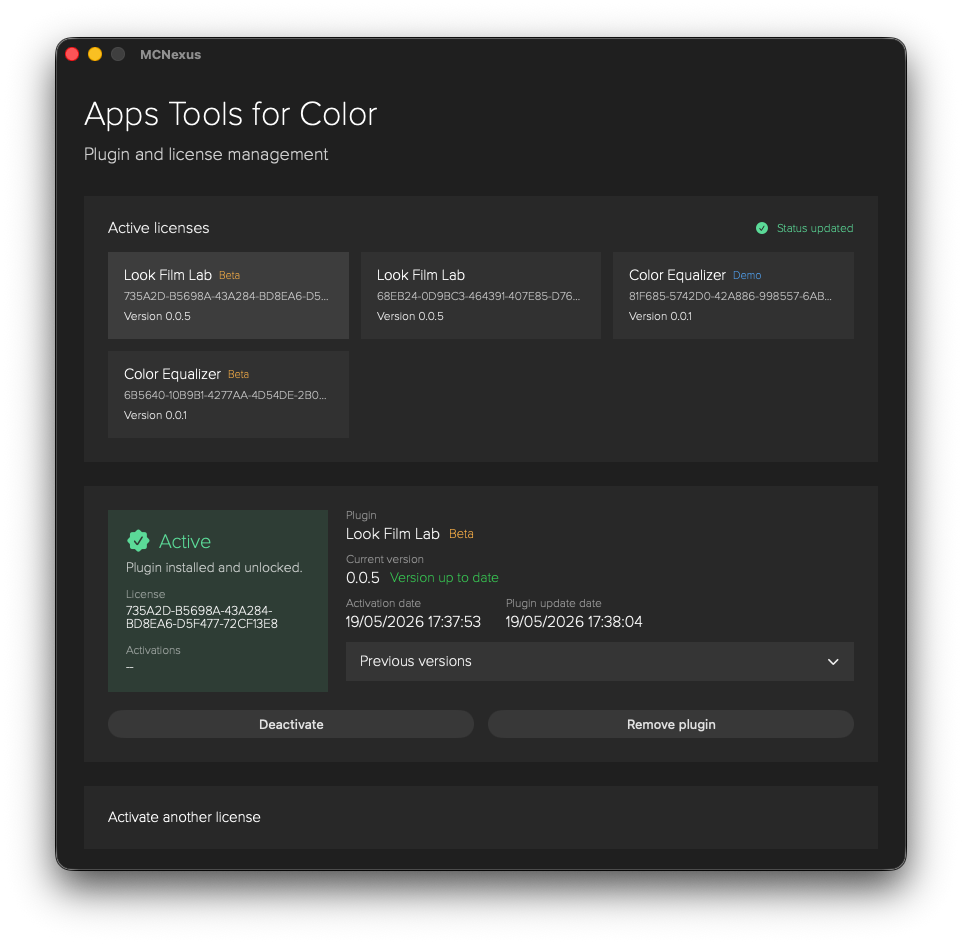
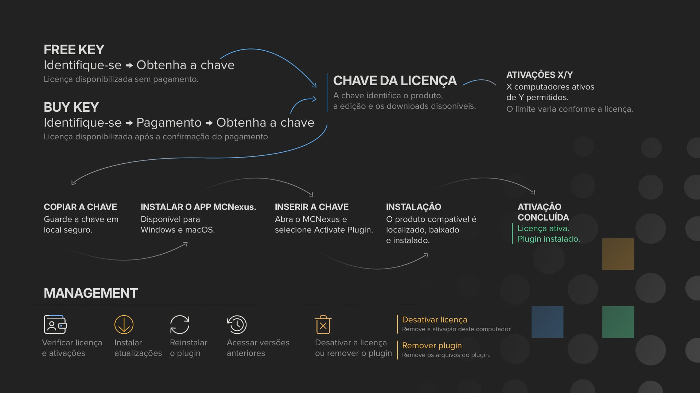

---

[English](../README.md) · [Português](README.md) · [Website](https://mcnexus.app/pt-BR/)

**Infraestrutura de distribuição, licença e updates para plugins.**

Checkout integrado, licenciamento node-lock, instalador nativo e atualizações
no macOS e Windows, com conversão de DCTL para OFX nativa, controle por
hardware MIDI e Sandbox da SDK pronto para rodar.

O Nexus é infraestrutura para licenciar, distribuir e atualizar plugins e
software nativo de desktop: certificados de ativação assinados por tenant e
vinculados ao hardware da máquina, uma janela de validade offline que
sobrevive a dias sem rede, entrega protegida de releases, rollback para uma
versão anterior, empacotamento DCTL-to-OFX e controle por hardware MIDI
(`NexControl`). O MCNexus é o aplicativo para macOS e Windows que executa
ativação, instalação, atualizações, rollback e roteamento do hub MIDI na
estação de trabalho.

<table>
  <tr>
    <td width="65%">
      
    </td>
    <td>
      
       
      <small>Opção recomendada para Windows</small>
        
      
       
      
    </td>
  </tr>
</table>

A **Microsoft Store é o canal oficial e recomendado para instalação no Windows**, garantindo integridade de código e atualizações automáticas em segundo plano. O instalador `.exe` continua disponível no GitHub como alternativa para instalação manual.

> **Observação sobre a instalação:** o instalador direto para Windows distribuído pelo GitHub ainda não possui assinatura de código e pode exibir um alerta do Microsoft Defender SmartScreen. A versão para macOS ainda não possui assinatura com certificado Apple Developer ID nem notarização pela Apple, portanto o Gatekeeper também pode exibir um alerta. Os downloads oficiais estão disponíveis na Microsoft Store e neste repositório.

## Plugins Integrados

Lista de plugins OFX integrados ao Nexus.

[Ver plugins integrados](docs/DISCOVERY.md) · [Indicar um plugin](https://github.com/ciqueira/MCNexus/issues/new?template=plugin_suggestion.yml)

## Operação em Ilhas de Pós-Produção

O MCNexus cuida do ciclo de vida dos plugins instalados na estação de trabalho, da primeira ativação à instalação de uma versão anterior.

- **Instalação automática:** baixa e instala os pacotes OFX no diretório nativo definido pelo sistema operacional.
- **Atualização e rollback:** identifica versões publicadas e permite instalar uma atualização ou retornar a uma versão anterior disponível, conferindo a integridade SHA256 antes da instalação.
- **Ações independentes:** ativar uma licença, desativá-la, remover a chave local e remover os arquivos do plugin são operações separadas.
- **Controle por hardware MIDI (`NexControl`):** conecta controladoras MIDI físicas compatíveis a plugins OFX no DaVinci Resolve com detecção automática do node em foco, paginação em bancos virtuais e perfis customizáveis, sem exigir permissões de Acessibilidade.
- **Transferência entre computadores e ilhas offline:** quando o computador anterior está acessível, desative a licença nele antes de ativar em outra máquina; ambientes sem internet operam via arquivos exportados. Liberações remotas continuam sendo tratadas pelo suporte.

[Começar pelo Guia de Operação](docs/USER_GUIDE.md)

## Para Desenvolvedores

Backend, SDK nativa e aplicativo cliente para software comercial ou open source. As integrações operam ponta a ponta (do checkout integrado à instalação na estação) ou acopladas a uma loja ou emissor externo existente. Configuradas projeto a projeto; o onboarding self-service público está no [roadmap](docs/ROADMAP.md).

- **SDK Nativa (`NexKeyRuntime`).** C/C++ com ABI C estável (`1.0`) para macOS universal (`arm64` e `x86_64`), Windows x64 e Windows ARM. Na thread de render, a decisão de licença é uma leitura atômica em memória, sem chamadas de rede ou acesso a disco. Suporta ativação vinculada ao hardware, janela offline configurável (até 365 dias), ativação *air-gap* por arquivo e Developer Sandbox local para testes antes do onboarding.
  → [NexKeyRuntime](https://github.com/ciqueira/NexKeyRuntime) · [Integração](https://github.com/ciqueira/NexKeyRuntime/blob/main/docs/INTEGRATION.md) · [Política de ABI](https://github.com/ciqueira/NexKeyRuntime/blob/main/docs/ABI_POLICY.md) · [Licenciamento e SDK](docs/developers/LICENSING.md)

- **Aplicativo MCNexus, Updates e Rollback.** O aplicativo para macOS e Windows executa ativação, instalação, atualizações por canal e rollback com verificação SHA256. Ativar fora do host mantém o Inspector do plugin limpo, evita gravar credenciais do usuário em arquivos de projeto (como `.drp`) e promove licenças `Demo` ou `Trial` para `Full` na mesma chave sem reinstalar nem quebrar timelines salvas.
  → [Guia de Operação](docs/USER_GUIDE.md) · [Releases e rollback](docs/developers/RELEASES.md)

- **Empacotamento DCTL-to-OFX.** Transforma scripts DCTL e LUTs 3D em plugins OpenFX nativos sem programar C++, executados em GPU no macOS (Metal) e Windows (OpenCL).
  → [Guia DCTL-to-OFX](docs/developers/DCTL.md)

- **Controle por Hardware MIDI (`NexControl`).** Integra superfícies MIDI físicas a parâmetros OpenFX com detecção automática do node em foco no macOS e Windows, paginação em bancos virtuais, resposta adaptativa de encoders e perfis embutidos ou JSON customizável.
  → [Guia MIDI NexControl](docs/developers/MIDI.md)

- **Commerce, Avisos no Produto e Continuidade.** Suporta vendas diretas pela conta de pagamento do desenvolvedor (ou loja externa via API) com registro de aceite e entrega transacional, avisos localizados segmentados por host e versão, além de chave de assinatura e recuperação sob posse do criador para manter instalações operando de forma independente da infraestrutura Nexus.
  → [Commerce e Fulfillment](docs/developers/COMMERCE.md) · [Updates e avisos](https://github.com/ciqueira/NexKeyRuntime/blob/main/docs/UPDATES_AND_NOTICES.md) · [Continuidade e recuperação](docs/CONTINUITY.md)

[Ler a Documentação para Desenvolvedores](docs/DEVELOPERS.md)

## Compatibilidade do Aplicativo

- **macOS:** macOS 15 ou posterior, incluindo Apple Silicon e Macs Intel compatíveis.
- **Windows:** Windows 10/11 x64, com suporte ao Windows 11 ARM por emulação x64.
- **Linux:** em consideração quando os plugins compatíveis e a demanda dos
  usuários justificarem o ciclo adicional de plataforma.

## Projeto

O Nexus combina engenharia de software com experiência prática em pós-produção
audiovisual. Desenvolvido de forma independente por
[Magno Ciqueira](https://www.linkedin.com/in/ciqueira/)
([Instagram](https://www.instagram.com/magnociqueira/)), o projeto tem como
objetivo reduzir fricções técnicas e oferecer infraestrutura de distribuição
para ferramentas comerciais e de código aberto.

## Documentação

- [Plugins Integrados](docs/DISCOVERY.md)
- [Guia de Operação](docs/USER_GUIDE.md)
- [Documentação para Desenvolvedores](docs/DEVELOPERS.md)
- [Empacotamento DCTL-to-OFX](docs/developers/DCTL.md)
- [Controle por Hardware MIDI (NexControl)](docs/developers/MIDI.md)
- [Perguntas Frequentes](docs/FAQ.md)
- [Roadmap](docs/ROADMAP.md)
- [Continuidade e Recuperação](docs/CONTINUITY.md)
- [Licença](../LICENSE.md)
- [Aviso sobre o Código-Fonte](../NOTICE.md)
- [Aviso de Marcas](../TRADEMARKS.md)
- [Política de Segurança](../SECURITY.md)
- [Termos de Uso](TERMS.md)
- [Política de Privacidade](PRIVACY.md)
- [Guia de Documentação Legal por Tenant](docs/TENANT_LEGAL_GUIDE.md)

## Disponibilidade do Código-Fonte

Este repositório é público para transparência e revisão. Ele é source-available, mas não é software open source. Redistribuição, builds não oficiais, produtos derivados e uso da marca MCNexus exigem autorização prévia por escrito. Consulte [LICENSE.md](../LICENSE.md), [NOTICE.md](../NOTICE.md) e [TRADEMARKS.md](../TRADEMARKS.md).

## Suporte

Problemas técnicos, dúvidas de ativação, relatórios de falhas e sugestões devem ser registrados pelos [formulários de suporte do GitHub](https://github.com/ciqueira/MCNexus/issues/new/choose). Inclua a versão do sistema operacional, a versão do MCNexus, o plugin afetado e os diagnósticos disponíveis.

O GitHub Issues é público e indexado por mecanismos de busca. Não publique uma chave de licença completa nem dados pessoais. Solicitações de privacidade devem ser enviadas para [hello@mcnexus.app](mailto:hello@mcnexus.app).
